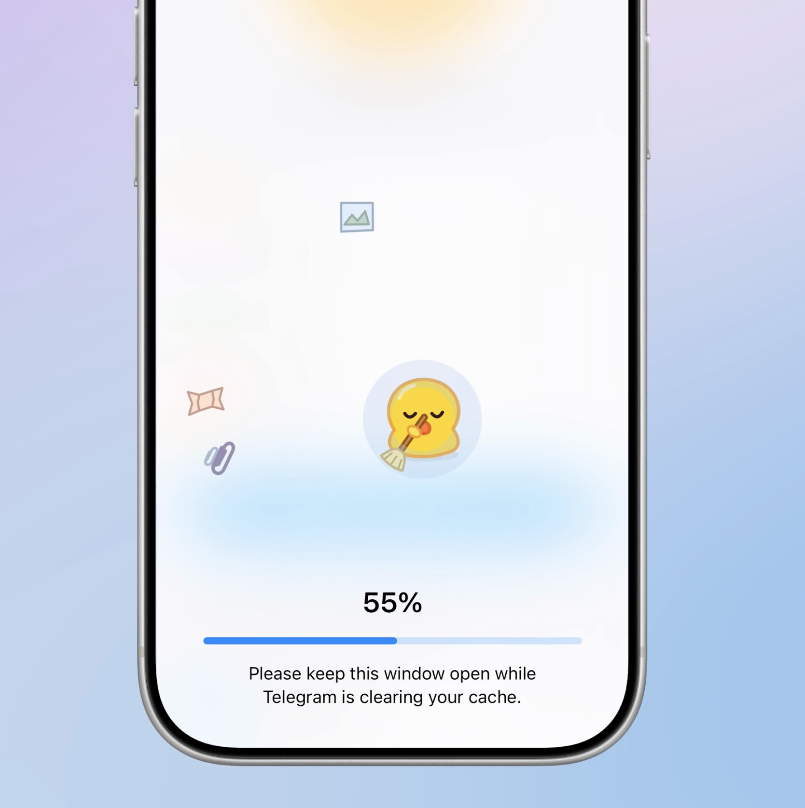

# 🦆 Cache Cleanup Mini-Game

What if you could help Telegram’s little duck sweep while your cache clears?



## How it works

1. In Telegram for iOS, open **Settings → Data and Storage → Storage Usage**.
2. Tap **Clear Entire Cache**, then tap the duck while the progress bar is running.
3. Drag the duck across the screen to sweep up scraps, wrappers, and paper clips.
4. When cleanup finishes, Telegram shows its familiar **Storage Cleared** screen.

This is an unofficial concept by **Stanislav Rybalko**. The simulator uses a 12-second demo and leaves the cache intact.

## Try it

Apply [`cache-sweep.patch`](cache-sweep.patch) to [Telegram-iOS](https://github.com/TelegramMessenger/Telegram-iOS) at the original base commit, then follow the [upstream build instructions](https://github.com/TelegramMessenger/Telegram-iOS#compilation-guide) for an iOS simulator build.

```sh
git clone https://github.com/TelegramMessenger/Telegram-iOS.git
cd Telegram-iOS
git checkout fb0e62ba8a147f0821da6aa63c09da7d79a10111
git submodule update --init --recursive
git apply /path/to/telegram-cache-sweep/cache-sweep.patch
```

The changed Swift files are also included under [`submodules/`](submodules) for browsing. [View the original implementation commit](https://github.com/rybalko61/Telegram-iOS/commit/a6ea380f71d0dfbffd1d1743714741191dc6bf99).

## License

Source code and patch are available under [GPL-2.0-or-later](LICENSE). Telegram and its existing artwork are credited to their respective owners.
